# VocaSee

**A voice-guided indoor object finder for Android, built for visually impaired users.**

Say the name of an object, and VocaSee looks for it through the phone's camera. It then guides you to it with spoken feedback, vibration, and hand-to-object proximity guidance. Object detection runs fully on the device using a YOLO26n model in TensorFlow Lite, so camera frames are never sent to a cloud service.

  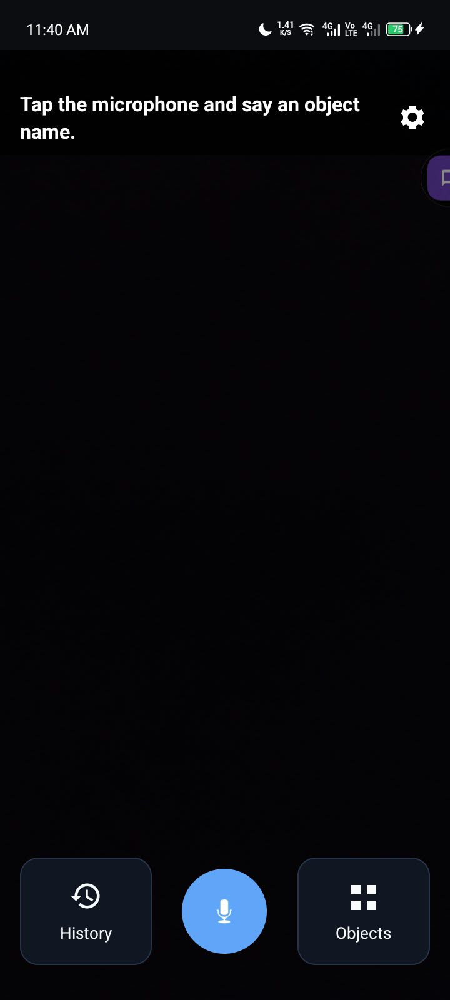
  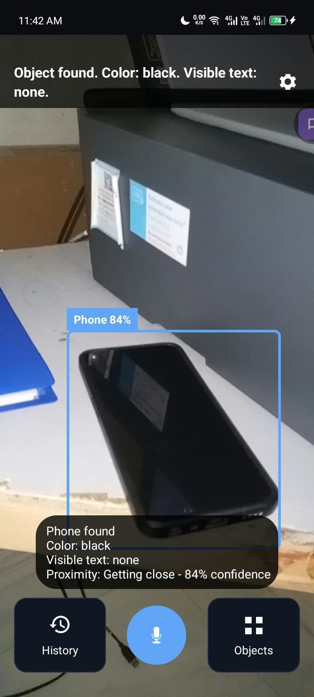
  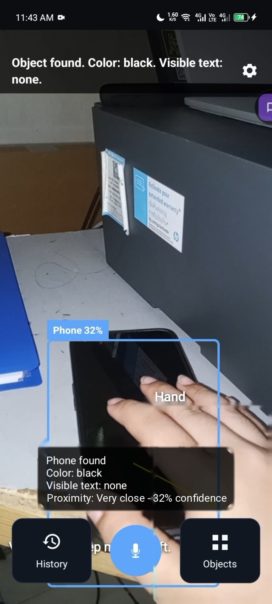

> VocaSee was developed as an undergraduate thesis, *Voice-Guided Indoor Object Finder Android Application for Visually Impaired Users*, for the Bachelor of Science in Computer Science at the College of Computer Studies, Laguna State Polytechnic University – San Pablo City Campus (2026).

---

## Contents

- [Features](#features)
- [Supported objects](#supported-objects)
- [Screenshots](#screenshots)
- [How it works](#how-it-works)
- [Tech stack](#tech-stack)
- [Model](#model)
- [Evaluation results](#evaluation-results)
- [Requirements](#requirements)
- [Getting started](#getting-started)
- [Limitations](#limitations)
- [Authors](#authors)

---

## Features

- **Voice command search.** Tap the microphone and say one object name, such as "phone" or "charger."
- **Object list search.** Pick an object from a list to start detection without speaking.
- **Near real-time, on-device detection.** A YOLO26n model in TensorFlow Lite analyzes the live rear-camera feed.
- **Spoken descriptions.** VocaSee announces the object's dominant color, its relative position, how close it is, and any visible text it can read (on-device OCR).
- **Haptic radar feedback.** The phone vibrates faster as you get closer to the object.
- **Hand proximity guidance.** When your hand is visible to the camera, VocaSee tracks it and tells you how close your hand is to the object (for example, "Very close").
- **Yes or no voice prompts.** The app can ask a question and listen for a spoken "yes" or "no."
- **Recent searches.** Optional search history that you can clear at any time.
- **Accessibility settings.** Theme, text size, vibration, voice guide, TalkBack compatibility, sound effects, speech speed, detection sensitivity, auto-flashlight in dim light, confidence display, and color description.
- **Voice tutorial.** A short first-run tutorial that can be replayed from Settings.

## Supported objects

VocaSee recognizes **24 household objects**.

| | | | |
|---|---|---|---|
| Backpack | Book | Body scrub | Body spray |
| Cane | Card | Charger | Comb |
| Cup | Flashlight | Glasses | Glasses case |
| Headset | Key | Lighter | Medicine |
| Nail clipper | Phone | Remote | Shoe |
| Towel | Wallet | Watch | Water bottle |

Requests for objects outside this list are announced as unsupported.

## Screenshots

### Getting started

| Welcome | Tutorial: find an object | Tutorial: feedback |
|:---:|:---:|:---:|
| 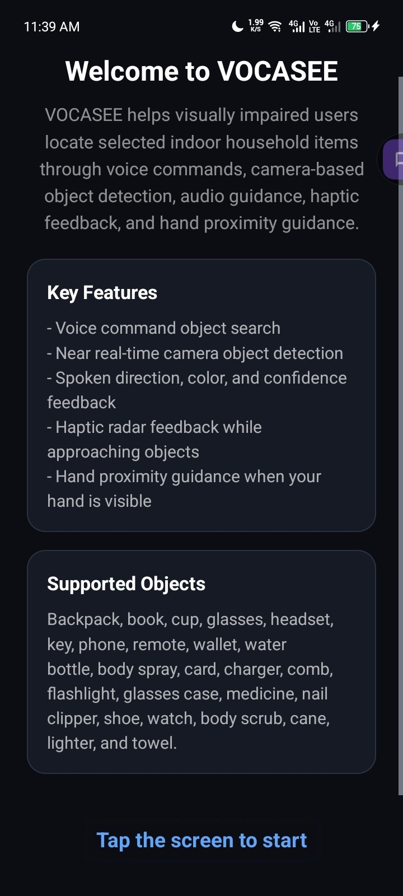 | 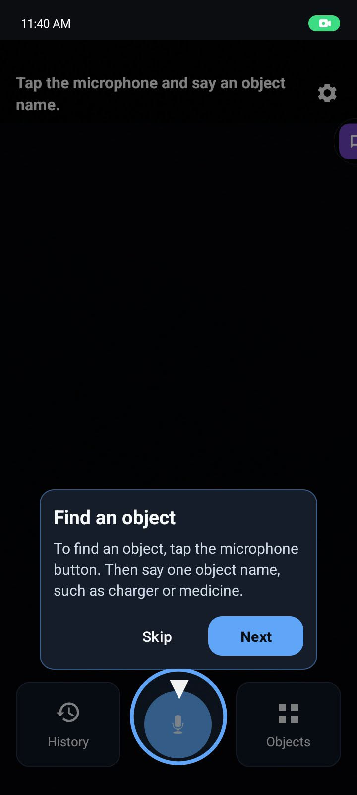 | 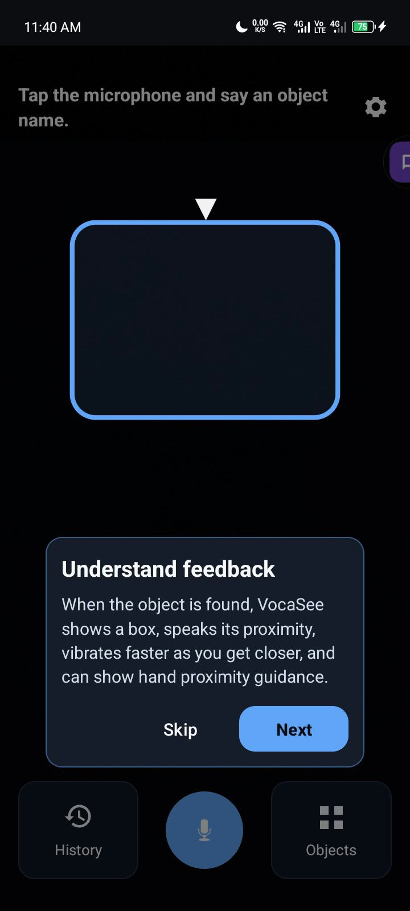 |

### Finding an object

| Main screen | Listening for a command | Object found |
|:---:|:---:|:---:|
|  | 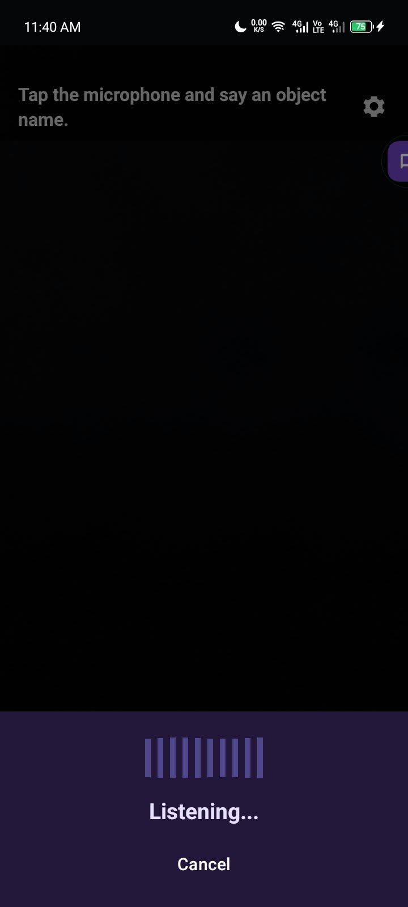 |  |

| Hand proximity guidance | Yes or no prompt |
|:---:|:---:|
|  | 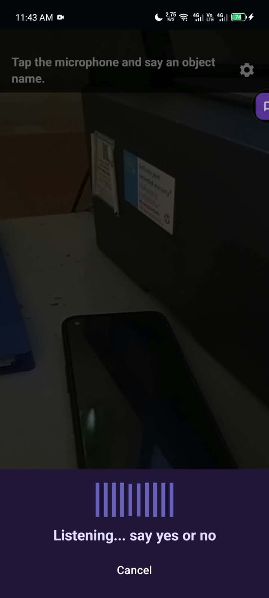 |

### History, object list, and settings

| Recent searches | Object list | Settings | Settings (continued) |
|:---:|:---:|:---:|:---:|
| 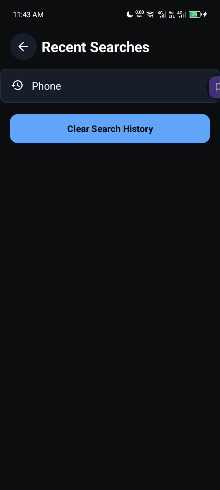 | 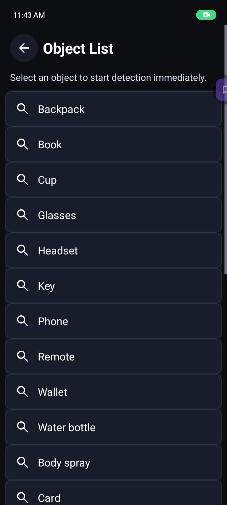 | 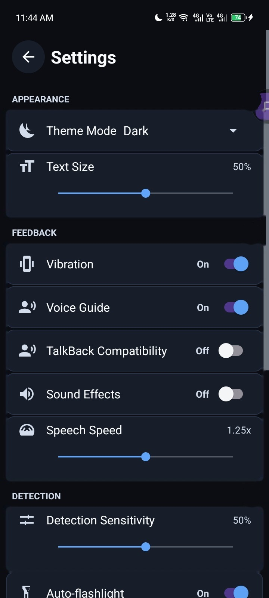 | 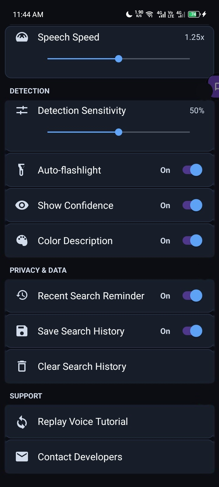 |

## How it works

1. **Request.** The user says an object name (Android SpeechRecognizer) or selects it from the object list.
2. **Detect.** CameraX streams rear-camera frames to the YOLO26n TensorFlow Lite model, which looks for the requested class. If several instances are detected, the one with the highest confidence is selected and tracked.
3. **Describe.** VocaSee builds a rule-based description from the object's dominant color (OpenCV), its relative position, and any text recognized by Google ML Kit Text Recognition.
4. **Guide.** Spoken feedback (TextToSpeech), vibration (Vibrator / VibratorManager), and sound cues (ToneGenerator) guide the user toward the object. MediaPipe Hand Landmarker tracks the user's hand for hand-to-object proximity guidance.

Settings and preferences are stored locally with Jetpack DataStore Preferences.

## Tech stack

| Component | Version |
|---|---|
| Java | 11 |
| Android Studio | Panda 4 (2025.3.4) |
| TensorFlow Lite | 2.17.0 |
| CameraX | 1.3.4 |
| Google ML Kit Text Recognition | 16.0.1 |
| OpenCV Android | 4.5.2 |
| MediaPipe Tasks Vision (Hand Landmarker) | 0.10.35 |
| Jetpack DataStore Preferences | 1.1.1 |
| AndroidX AppCompat | 1.6.1 |
| ConstraintLayout | 2.1.4 |
| Material Components | 1.10.0 |
| Android APIs | SpeechRecognizer, TextToSpeech, Vibrator / VibratorManager, ToneGenerator |

**Model training:** Ultralytics YOLO on Google Colab (NVIDIA GPU). Images were annotated in YOLO format with LabelImg 1.8.1.

## Model

Four Ultralytics YOLO nano models (YOLOv5n, YOLOv8n, YOLO11n, and YOLO26n) were trained on a custom dataset of **7,920 images** across the 24 classes. The images were collected by the researchers and supplemented from Kaggle and Roboflow Universe. Each model was trained on both a 70:20:10 and an 80:10:10 train/validation/test split.

**YOLO26n trained on the 80:10:10 split (default 100 epochs)** was selected and integrated into the app.

### Detection results (80:10:10 split, test set)

| Model | mAP@50 | mAP@50–95 | Precision | Recall |
|---|---|---|---|---|
| YOLOv5n | 89.57% | 71.78% | 89.77% | 82.78% |
| YOLOv8n | 90.05% | 73.65% | 90.69% | 84.30% |
| YOLO11n | 90.33% | 74.59% | **92.50%** | 85.16% |
| **YOLO26n** | **91.28%** | **76.58%** | 90.59% | **87.47%** |

### On-device performance

Benchmarked on a realme 8 5G (Android 13) with TensorFlow Lite 2.17.0, 4 CPU threads, FLOAT32, and 640 × 640 input. Each model had 300 recorded inferences. Times cover the model forward pass only.

| Model | Mean inference time (ms) | Derived FPS | Parameters | TFLite size (MB) |
|---|---|---|---|---|
| YOLOv5n | 257.452 | 3.884 | 2,641,208 | 10.794 |
| YOLOv8n | 273.155 | 3.661 | 3,015,528 | 12.275 |
| YOLO11n | 244.291 | 4.093 | 2,594,520 | 10.646 |
| **YOLO26n** | **230.179** | **4.344** | **2,513,160** | **9.853** |

A YOLO26n retrained to 150 epochs did not improve mAP@50 (91.27% vs. 91.28%) and ran slower on the device (395.455 ms), so the default-epoch model was kept.

## Evaluation results

Nine visually impaired participants each completed three trials of manual searching and three trials of app-assisted searching (27 trials per condition).

| Measure | Manual searching | With VocaSee |
|---|---|---|
| Mean undesired-object touches per trial | 3.74 | **1.00** (about 73% fewer) |
| Trials with no undesired touch | 0 of 27 | **13 of 27** |
| Successful completions | 27 of 27 (100%) | 21 of 27 (77.8%) |
| Mean search time | 9.63 s | 19.52 s |

- **Usability (System Usability Scale):** mean score of **64.44** (OK, marginally acceptable).
- **Software quality (ISO/IEC 25010:2023):** rated **4.47 out of 5.00 (Excellent)** by five IT/CS experts.

VocaSee greatly reduced unnecessary contact with surrounding objects, including fragile or hazardous items, and it adds color and text identification that touch alone cannot provide. Manual searching was still faster and more accurate, and most of the app's errors involved the medicine class. Improving detection reliability and response speed is the main next step.

## Requirements

- An Android phone running **Android 8.0 (API 26) or later**, with a rear camera, microphone, speaker, and vibration motor
- Camera and microphone permissions
- iOS is not supported

## Limitations

- Only the 24 supported object classes are detected, and only one object class is searched at a time.
- Detection and text recognition can be affected by poor lighting, clutter, occlusion, motion blur, reflective surfaces, small labels, unusual angles, and similar-looking objects.
- When several matching objects are visible, the app tracks one of them. It cannot confirm that it is the user's own item.
- **For medicine, VocaSee only helps locate the item.** It does not verify the medicine's identity, label, dosage, or whether it is safe to take.
- Voice commands mainly support English, and recognition depends on the device's speech-recognition service, pronunciation, and background noise.
- Performance depends on the phone's processor, memory, camera, and Android version.

## Authors

- **Amazing Grace O. Cabiles**
- **Cyrelle Kristin P. Gapit**
- **Francen P. Manalo**

College of Computer Studies, Laguna State Polytechnic University – San Pablo City Campus

<!-- TODO: add a License section once you choose one (for example, MIT) -->
